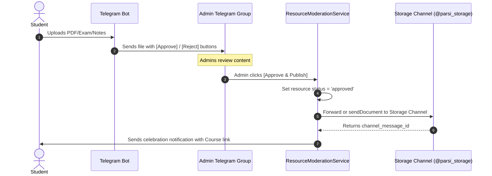
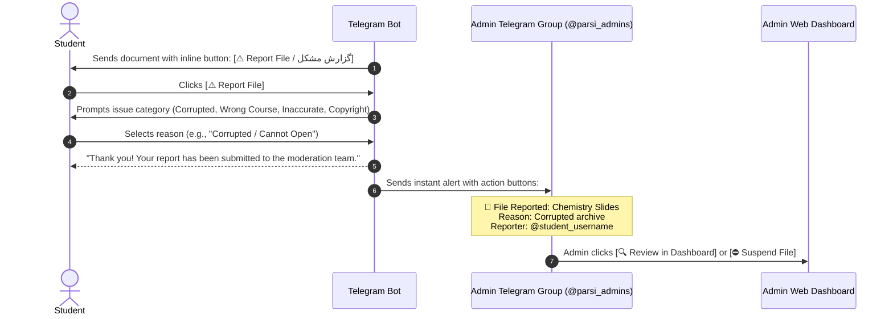
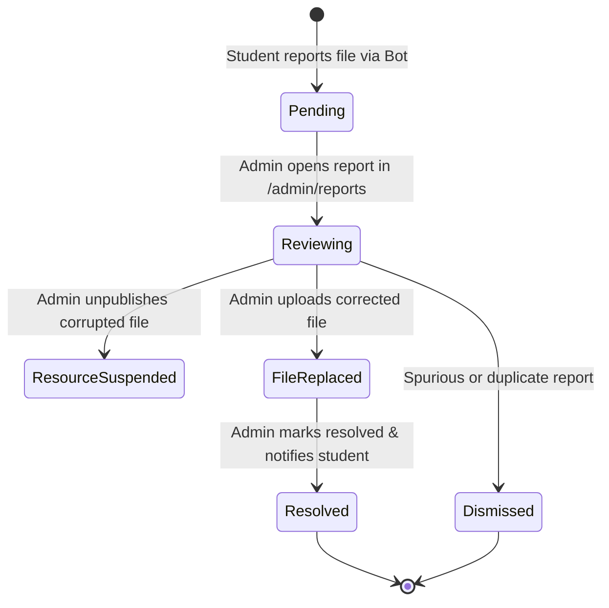

# PARSI Education Bot - Architecture & Enhancements Roadmap

**Project owner:** PARSI Educational Committee, Politecnico di Torino  
**Document status:** Active Development & Execution Plan  
**Last updated:** 19 October 2026

---

## 📊 Executive Roadmap Dashboard & Status Matrix

| # | Enhancement Feature | Status | Components Affected | Priority |
| :--- | :--- | :---: | :--- | :---: |
| **1** | **Google Drive Manual & Batch Sync in Admin** | 🟡 Partial | Admin Controller, Views, GoogleDriveService | High |
| **2** | **Telegram Storage Channel Auto-Archival** | 🟡 Ready for Wiring | `ResourceModerationService`, Telegram CDN | High |
| **3** | **Automated Malware & Antivirus Scanner** | ⏳ Planned | `FileUploadHandler`, Security Pipeline | Medium |
| **4** | **Community vs. Official Resource Distinctions** | ✅ **Completed** | Admin Views, Eloquent Models, Filters | Done |
| **5** | **Student Issue Reporting via Telegram Bot** | 🟡 In Progress | Bot Keyboards, Handlers, `resource_reports` | High |
| **6** | **Live Log Viewer & Real-Time Monitoring** | ⏳ Planned | `/admin/logs`, SSE Streaming, Console UI | Medium |
| **7** | **Dedicated Reports Center (`/admin/reports`)** | 🟡 In Progress | ReportAdminController, Blade Views | High |
| **8** | **Performance & Latency Optimization** | 🟡 Partial | Caching, Eager-Loading, Timeout Tuning | Medium |
| **9** | **In-Chat, Group & Inline Query Search Engine** | ✅ **Completed** | `InlineQueryHandler`, Group Mention, Direct Send | Done |
| **10**| **Live Download & Inline Click Analytics Counter**| ✅ **Completed** | `chosen_inline_result`, Admin KPI & Table | Done |
| **11**| **Email & Password Admin Authentication** | ✅ **Completed** | `AdminAuthController`, Login view, CLI set | Done |
| **12**| **Multi-Tier Role System (Admin/Editor/Prof/Viewer)**| ✅ **Completed** | `/admin/users`, User model, RBAC policies | Done |
| **13**| **Informational Sections (EDISU, Deadlines)** | ⏳ Queued | `bot.php`, `MessageHandler`, Static Guides | Normal |

---

## 1. Google Drive Manual & Batch Sync in Admin Panel

### Objective
Allow administrators to manually trigger Google Drive uploads for any resource file directly from the Admin Panel, as well as run batch synchronization for all materials missing a Google Drive backup.

### Current State
- When a resource is uploaded via the admin panel, `GoogleDriveService` uploads the file and stores `drive_file_id`.
- If Google Drive encounters a network timeout or token issue, files can remain with `drive_file_id = NULL` (`No Drive Backup`).
- Needs per-file manual retry button and a global batch sync button.

### Proposed Architecture & Implementation
1. **Controller Endpoints (`ResourceAdminController`)**:
   - `POST /admin/resources/{resource}/sync-drive`: Triggers an immediate Google Drive upload for all files belonging to a specific resource.
   - `POST /admin/resources/sync-drive-all`: Queries all `ResourceFile` records where `drive_file_id IS NULL` and dispatches `UploadResourceFileJob` for each.
2. **UI Enhancements**:
   - **Per-row button**: In the resource table and on the Edit page, add a `🔄 Sync to Drive` button next to files with `⚪ No Drive Backup`.
   - **Batch sync button**: In the Quick Stats header, add a `☁️ Sync All to Drive (X pending)` action button.
   - **OAuth Health Indicator**: Display an alert if the Google Drive refresh token is expired, with a direct link to `/google/auth` to re-authorize in one click.

---

## 2. Automated Archival to Telegram Storage Channel upon Approval

### Objective
When a user submits a material via the Telegram bot, it is sent to the Admin Review Group. Once an admin clicks **[✅ Approve & Publish]**, the file should automatically be archived to the official Telegram Storage Channel (`TELEGRAM_STORAGE_CHANNEL_ID`) for permanent CDN backup.

### Workflow Pipeline


### Technical Specification
1. **Database & Configuration**:
   - Migration `2026_10_18_170000_add_storage_channel_message_id_to_resource_files_table.php` is **already migrated**.
   - Config key: `config('telegram.storage_channel_id')` or `env('TELEGRAM_STORAGE_CHANNEL_ID')`.
2. **Service Method in `ResourceModerationService::approve`**:
   - Call `TelegramService::sendDocument()` targeting `TELEGRAM_STORAGE_CHANNEL_ID` with a formatted verified caption:
     ```
     📚 #ApprovedResource: Course Name
     📝 Title: Resource Title
     👤 Contributor: @username
     🗂️ Type: Exam / Summary
     ```
   - Store `storage_channel_message_id` on the `resource_files` record.

---

## 3. Automated Malware & Virus Scanner for Community Uploads

### Objective
Protect administrators, the server, and students from malicious files (trojans, malware, macro-enabled documents, malicious zip archives) uploaded through the Telegram bot.

### Multi-Layer Security Architecture

#### Layer 1: File Sanitization & Extension Whitelisting (Synchronous - Completed)
- **Strict MIME & Extension Matching**: Only allow safe documents (`.pdf`, `.zip`, `.docx`, `.pptx`).
- **Reject Executable Extensions**: Reject `.exe`, `.bat`, `.sh`, `.vbs`, `.js`, `.scr`, `.jar`, `.docm`, `.xlsm`.
- **Magic Bytes Verification**: Inspect file headers via PHP `finfo_file()` to ensure the declared extension matches the true binary signature.

#### Layer 2: Automated Antivirus Scanning Engine
- **Option A: ClamAV Daemon (`clamd`)**:
  - Open-source, runs on the host server or Docker container.
  - PHP communicates via UNIX/TCP socket (`clamdscan` / `quahog` client).
  - Fast local scanning (< 500ms for typical PDFs).
- **Option B: VirusTotal Public/Enterprise API**:
  - Hash-check first (SHA256) to see if the file is known to 70+ AV engines.
  - If unknown, upload the binary for scanning (asynchronous queue).

#### Moderation Handling on Infection
- If malware is detected:
  1. Immediately quarantine or delete the file from local storage.
  2. Mark resource as `status = 'rejected'` with reason: `Malware detected`.
  3. Log security incident with user's Telegram ID.
  4. Block further uploads from the offender if repeated.
  5. Alert admins in the group: `⚠️ Security Warning: Upload rejected due to malware detection.`

---

## 4. Community vs. Official PARSI Resource Distinctions in Admin Panel (✅ Completed)

### Implementation Overview
- **Submitter Identification**:
  - `isCommunitySubmission()`: `submitted_by IS NOT NULL AND users.role != 'admin'`.
  - `isOfficial()`: `submitted_by IS NULL OR users.role == 'admin'`.
- **Filtering**:
  - Admin filter dropdown: `All Sources`, `Community Submissions (Students)`, and `Official Materials (PARSI Team)`.
- **Visual Badges**:
  - Badges displaying student `@username`, Telegram User ID, and role.
  - Verified `🛡️ PARSI Official` badge for admin materials.
- **KPI Metrics**:
  - Stats card showing counts of Community submissions vs. Official uploads.

---

## 5. In-Chat, Group Mention & Inline Query Search Engine (✅ Completed)

### Implementation Overview
- **Private Chat Search**:
  - Search by course name, course code, title, and description.
- **Group Mention Search**:
  - In university group chats, students type `@parsi_politobot <keyword>`.
  - Clean inline keyboard results without navigation back buttons, keeping group chats uncluttered.
- **Telegram Inline Query Anywhere (`@parsi_politobot <keyword>`)**:
  - Single-file resource: Delivers the native document directly to the chat with the official `✅ Verified by PARSI` caption.
  - Multi-file resource: Sends a structured message with direct Google Drive links for all parts.
  - Bypasses external redirection so content stays directly in the conversation.

---

## 6. Live Download & Inline Click Analytics Counter (✅ Completed)

### Implementation Overview
- **Database Architecture**:
  - Migration `2026_10_18_194500_add_downloads_and_inline_shares_to_resources_table.php` added `downloads_count` and `inline_shares_count`.
- **Telegram Feedback Tracking**:
  - Telegram `chosen_inline_result` webhook updates are intercepted in `TelegramUpdateDispatcher`.
  - Increments `downloads_count` and `inline_shares_count` whenever a user selects a resource button.
  - Bot private delivery in `CallbackQueryHandler` increments `downloads_count`.
- **Admin Visibility**:
  - Total downloads and inline shares displayed in `AdminDashboardController` KPI cards.
  - Dedicated `Downloads & Shares` column on `/admin/resources` table.

---

## 7. Resource Reporting & Quality Feedback System (Student Flagging)

### Objective
Provide a feedback mechanism where students can report issues with downloaded study materials directly within the Telegram bot (e.g., corrupted archives, missing pages, wrong course/year attribution, or inaccurate solutions), alerting administrators instantly for review.

### Telegram User Experience & Delivery Flow

When any resource document is delivered to a student (via `send_resource_{id}`), the bot attaches an inline report button directly underneath the document:



### Technical Specification & Architecture

#### 1. Database Schema (`resource_reports` table - ✅ Migrated)
- `resource_id`: Target academic resource.
- `resource_file_id`: Specific file reported (if multi-file).
- `user_id`: Reporting student's Telegram user account.
- `reason`: Machine-readable category (`corrupted`, `wrong_course`, `inaccurate_solution`, `copyright`, `other`).
- `details`: Optional user-submitted comment.
- `status`: `pending` | `resolved` | `dismissed`.
- `admin_notes`: Resolution feedback.
- `resolved_by`: Admin user who audited the report.
- `resolved_at`: Audit timestamp.

#### 2. Telegram Inline Keyboard Integration
In `CallbackQueryHandler::handleSendResource`, every document sent includes an inline button:
```php
$replyMarkup = [
    'inline_keyboard' => [
        [
            ['text' => __('bot.resources.report_issue', [], $lang), 'callback_data' => "report_res_{$resource->id}"]
        ]
    ]
];
$this->telegram->sendDocument($chatId, $file->telegram_file_id, $caption, 'HTML', $replyMarkup);
```

#### 3. Reason Categories (Localized in EN, FA, IT)
- `corrupted`: 📁 Corrupted file / cannot open (فایل خراب است یا باز نمی‌شود)
- `wrong_course`: 📚 Wrong course or academic year (درس یا سال تحصیلی اشتباه است)
- `inaccurate_solution`: ✏️ Inaccurate or incomplete solutions (حل ناقص یا اشتباه است)
- `copyright`: 🛡️ Inappropriate or copyrighted material (محتوای نامناسب یا دارای کپی‌رایت)
- `other`: 💬 Other issue (سایر موارد)

#### 4. Instant Admin Group Alert
Sent to `TELEGRAM_ADMIN_CHAT_ID`:
```html
🚨 <b>Material Reported by Student</b>

📚 <b>Course:</b> Chemistry (06KWR)
📄 <b>File:</b> Chemistry-2024-2025-Practice-Part.zip
👤 <b>Reported by:</b> @devbravee (ID: <code>508762226</code>)
⚠️ <b>Reason:</b> Corrupted file / cannot open
🆔 <b>Resource ID:</b> <code>#4</code>
📅 <b>Reported At:</b> 2026-10-15 04:20
```
With inline buttons:
- `[🔍 Review in Admin Panel]` (links directly to `/admin/resources/4/edit`)
- `[⛔ Temporarily Suspend]` (callback: `report_suspend_4`)
- `[✅ Dismiss Report]` (callback: `report_dismiss_4`)

---

## 8. Dedicated Reports & Dispute Management Center (`/admin/reports`)

### Objective
Establish a centralized, dedicated admin hub (`/admin/reports`) for managing all student-flagged materials, coordinating file remediations, tracking moderation response times, and notifying reporters once issues are resolved.

### Workflow & Lifecycle


### Key Capabilities & UI Specifications
1. **Reports Dashboard View (`/admin/reports`)**:
   - ⚠️ **Open Reports**: Count of pending items requiring action.
   - 📁 **Top Flagged Courses**: Highlights courses with recurring material quality complaints.
   - 🛡️ **Resolved History**: Count of remediated materials.
   - Filter by Status (`Pending`, `Resolved`, `Dismissed`) and Reason.
2. **Moderation & Remediation Controls**:
   - `[🔍 Inspect Resource]`: Jump to edit page.
   - `[📥 Download Current File]`: Verify locally.
   - `[⛔ Suspend / Republish]`: Toggle resource status.
   - `[✅ Resolve & Notify Student]`: Marks resolved and sends notification message to the reporting student on Telegram.
   - `[❌ Dismiss Report]`: Closes with an internal moderator note.

---

## 9. Live Log Viewer & Real-Time Monitoring in Admin Panel (`/admin/logs`)

### Objective
Provide administrators with a real-time, terminal-style live log console directly within the Admin Panel. Enables immediate diagnostics for Telegram webhook events, background queue jobs, and API calls without needing SSH terminal access.

### Key Capabilities
1. **Real-Time Stream**:
   - Server-Sent Events (SSE) streaming `storage/logs/laravel.log` in real time with automatic reconnect.
2. **Filtering & Search**:
   - Filter by `ERROR`, `WARNING`, `INFO`, `DEBUG`.
   - Subsystem filtering: `Telegram Webhook`, `Google Drive Sync`, `Moderation Service`.
3. **Console Controls**:
   - Pause/Resume auto-scroll.
   - One-click clear view and log file download.

---

## 10. Student Informational Sections (EDISU, Deadlines, Support)

### Objective
Replace placeholder responses in the student bot main menu with interactive, helpful academic support services:
1. **`🔍 Edisu`**:
   - Quick guide on scholarship requirements, canteen access, accommodation rankings, and ISEE Parificato links.
2. **`❓ Important Deadlines`**:
   - Key dates for tuition installments, study plan submission deadlines, and official PoliTO exam sessions.
3. **`⚠️ Contact / Report`**:
   - Direct button to submit feedback or connect with the PARSI academic committee.

---

## 11. High-Speed Performance Optimization & Sub-Second Latency

### Performance Bottlenecks & Targets
| Metric | Current State | Target State | Optimization Technique |
| :--- | :--- | :--- | :--- |
| **Bot Menu Navigation** | ~250ms – 400ms | **< 150ms** | In-memory caching of Programs, Years, & Courses |
| **Resource Catalog Listing** | Eager-loaded (2 queries) | **< 100ms** | `with(['course', 'resourceType', 'files'])` |
| **Inline Query Search** | Live SQL search | **< 120ms** | Indexed title/code queries + 30s cache headers |
| **Telegram API Calls** | Safe cURL client (timeouts + proxy) | **Resilient** | Configurable proxy (`TELEGRAM_PROXY`), non-blocking callbacks |

---

## 📋 Immediate Execution Order

1. **Phase 1: Admin Reports Section (`/admin/reports`) & In-Bot Report Button** ✅ **(COMPLETED)**
   - `resource_reports` integrated with full CRUD/action management (`ReportAdminController`).
   - Admin UI (`index.blade.php`, `show.blade.php`) with real-time pending badge in navbar.
   - RBAC scoping: Super Admin & Moderator have full control; Major Admin/Professor scoped to their major; Viewer read-only.
   - Telegram inline buttons `[⚠️ Report Material]` on document deliveries and Google Drive links.
   - Full automated test suite in `tests/Feature/ReportAdminTest.php` passing 100%.
2. **Phase 2: Admin Live Log Viewer (`/admin/logs`)**
   - Build SSE log streaming controller and dark terminal view.
3. **Phase 3: Automated Archival to Telegram Storage Channel**
   - Forward approved community submissions to `TELEGRAM_STORAGE_CHANNEL_ID` and save message IDs.
4. **Phase 4: Google Drive Batch Sync**
   - Add batch upload retry endpoint and UI button in Admin Panel.
5. **Phase 5: Informational Sections (EDISU, Deadlines, Support)**
   - Fill static and dynamic guides for PoliTO student support.
