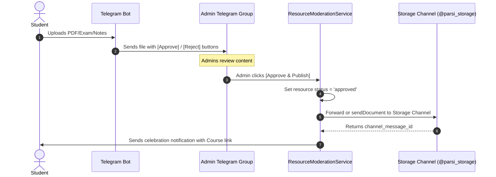
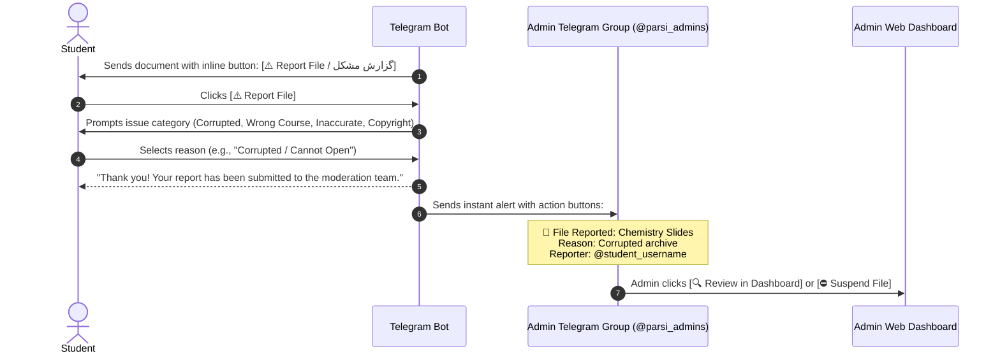
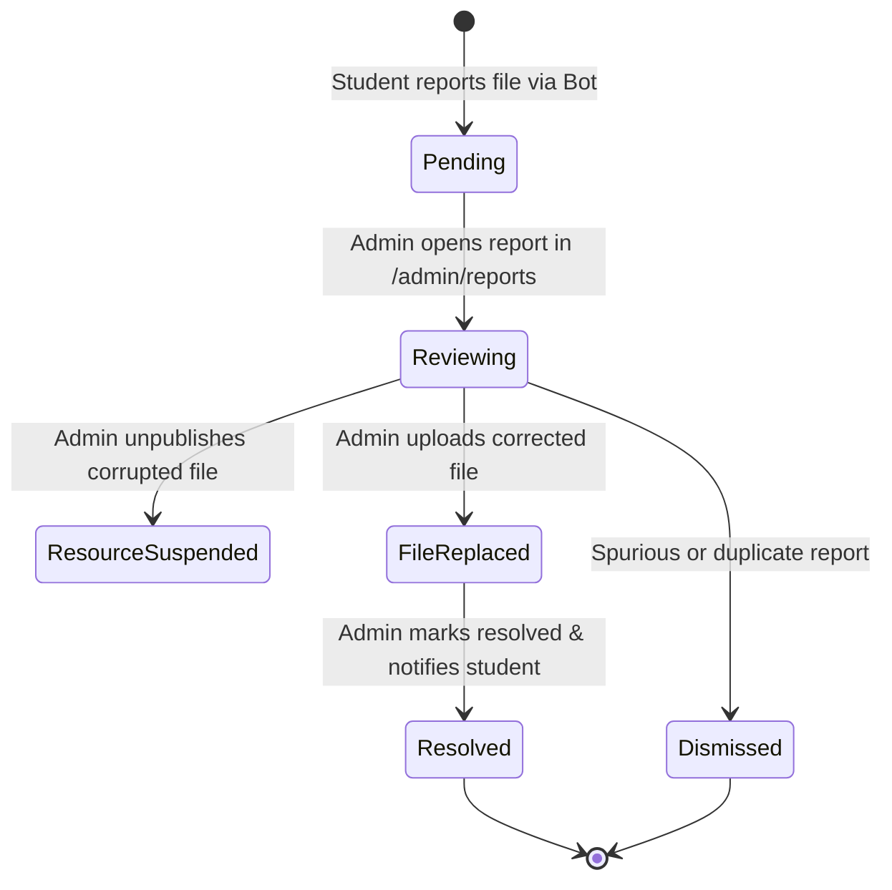

# PARSI Education Bot - Architecture & Enhancements Roadmap

This document outlines the design, technical specifications, and implementation roadmap for eight key platform enhancements.

---

## 1. Google Drive Manual & Batch Sync in Admin Panel

### Objective
Allow administrators to manually trigger Google Drive uploads for any resource file directly from the Admin Panel, as well as run batch synchronization for all materials missing a Google Drive backup.

### Current State
- When a resource is uploaded via the admin panel, `UploadResourceFileJob` is dispatched to sync to Telegram and Google Drive.
- However, if the Google Drive OAuth token was expired or a network timeout occurred, the resource remains with `drive_file_id = NULL` and `No Drive Backup`.
- There is currently no UI button in the admin panel to retry or force a sync to Google Drive.

### Proposed Architecture & Implementation
1. **Controller Endpoints (`ResourceAdminController`)**:
   - `POST /admin/resources/{resource}/sync-drive`: Triggers a sync for all files of a specific resource.
   - `POST /admin/resources/sync-drive-all`: Queries all `ResourceFile` records where `drive_file_id IS NULL` and dispatches `UploadResourceFileJob` for each.
2. **UI Enhancements**:
   - **Per-row button**: In the resource table and on the Edit page, add a `🔄 Sync to Drive` button next to files with `⚪ No Drive Backup`.
   - **Batch sync button**: In the Quick Stats header, add a `☁️ Sync All to Drive (X pending)` action button.
   - **OAuth Health Indicator**: Display an alert if the Google Drive refresh token is expired, with a direct link to `/google/auth` to re-authorize in one click.

---

## 2. Automated Archival to Telegram Storage Channel upon Approval

### Objective
When a user submits a material via the Telegram bot, it is sent to the Admin Review Group. Once an admin clicks **[✅ Approve & Publish]**, the file should automatically be archived to the official Telegram Storage Channel (`TELEGRAM_STORAGE_CHANNEL_ID`) for permanent CDN backup.

### Workflow Pipeline


### Technical Specification
1. **Config Key**:
   - `config('telegram.storage_channel_id')` or `env('TELEGRAM_STORAGE_CHANNEL_ID')`.
2. **Service Method in `ResourceModerationService::approve`**:
   - Call `TelegramService::sendDocument()` targeting `TELEGRAM_STORAGE_CHANNEL_ID` with a formatted caption:
     ```
     📚 #ApprovedResource: Course Name
     📝 Title: Resource Title
     👤 Contributor: @username
     🗂️ Type: Exam / Summary
     ```
   - Store `telegram_storage_message_id` on the `resource_files` record.

---

## 3. Automated Malware & Virus Scanner for Community Uploads

### Objective
Protect administrators, the server, and students from malicious files (trojans, malware, macro-enabled documents, malicious zip archives) uploaded through the Telegram bot.

### Multi-Layer Security Architecture

#### Layer 1: File Sanitization & Extension Whitelisting (Synchronous)
- **Strict MIME & Extension Matching**: Only allow safe documents (`.pdf`, `.zip` with inspection, `.docx`, `.pptx`).
- **Reject Executable Extensions**: Reject `.exe`, `.bat`, `.sh`, `.vbs`, `.js`, `.scr`, `.jar`, `.docm`, `.xlsm`.
- **Magic Bytes Verification**: Inspect file headers via PHP `finfo_file()` to ensure the declared extension matches the true binary signature.

#### Layer 2: Automated Antivirus Scanning Engine
- **Option A: ClamAV Daemon (`clamd`)**:
  - Open-source, free, runs on the host server or Docker container.
  - PHP communicates via UNIX/TCP socket (`clamdscan` / `quahog` client).
  - Fast local scanning (< 500ms for typical PDFs).
- **Option B: VirusTotal Public/Enterprise API**:
  - Hash-check first (SHA256) to see if the file is known to 70+ AV engines.
  - If unknown, upload the binary for scanning (asynchronous queue).

#### Moderation Handling on Infection
- If virus detected:
  1. Immediately quarantine or delete the file from local storage.
  2. Mark resource as `status = 'rejected'` with reason: `Malware detected`.
  3. Log security incident with user's Telegram ID.
  4. Block further uploads from the offender if repeated.
  5. Alert admins in the group: `⚠️ Security Warning: Upload rejected due to malware detection.`

---

## 4. Community vs. Official PARSI Resource Distinctions in Admin Panel (Implemented)

### Objective
Allow administrators in the Admin Panel to easily distinguish between:
1. **🛡️ Official PARSI Resources**: Uploaded directly by administrators from the admin web panel.
2. **👤 Community Submissions**: Submitted by university students via the Telegram bot.

### Implementation Details
- **Submitter Identification**:
  - `isCommunitySubmission()`: `submitted_by IS NOT NULL AND users.role != 'admin'`.
  - `isOfficial()`: `submitted_by IS NULL OR users.role == 'admin'`.
- **Filtering**:
  - Admin filter dropdown: `All Sources`, `Community Submissions (Students)`, and `Official Materials (PARSI Team)`.
- **Visual Badges**:
  - Badges displaying student `@username`, Telegram User ID, and role.
  - Verified `🛡️ PARSI Official` badge for admin materials.
- **KPI Metrics**:
  - Stats card showing counts of Community submissions vs. Official uploads.

---

## 5. Resource Reporting & Quality Feedback System (Student Flagging)

### Objective
Provide a feedback mechanism where students can report issues with downloaded study materials directly within the Telegram bot (e.g., corrupted archives, missing pages, wrong course/year attribution, or inaccurate solutions), alerting administrators instantly for review.

### Telegram User Experience & Delivery Flow

When any resource document is delivered to a student (via `send_resource_{id}`), the bot attaches an inline report button directly underneath the document:



### Technical Specification & Architecture

#### 1. Database Schema (`resource_reports` table)
```php
Schema::create('resource_reports', function (Blueprint $table) {
    $table->id();
    $table->foreignId('resource_id')->constrained()->cascadeOnDelete();
    $table->foreignId('resource_file_id')->nullable()->constrained()->nullOnDelete();
    $table->foreignId('user_id')->constrained()->cascadeOnDelete(); // Reporting student
    $table->string('reason', 100); // corrupted, wrong_course, inaccurate_solution, copyright, other
    $table->text('details')->nullable();
    $table->enum('status', ['pending', 'resolved', 'dismissed'])->default('pending');
    $table->foreignId('resolved_by')->nullable()->constrained('users')->nullOnDelete();
    $table->timestamp('resolved_at')->nullable();
    $table->timestamps();

    $table->index(['resource_id', 'status']);
});
```

#### 2. Telegram Inline Keyboard Integration
In `CallbackQueryHandler::handleSendResource`, every document sent includes an inline button:
```php
$replyMarkup = [
    'inline_keyboard' => [
        [
            ['text' => __('bot.resources.report_issue', [], $lang), 'callback_data' => "report_res_{$resource->id}"]
        ]
    ]
];
$this->telegram->sendDocument($chatId, $file->telegram_file_id, $caption, 'HTML', $replyMarkup);
```

#### 3. Reason Categories (Localized in EN, FA, IT)
- `corrupted`: 📁 Corrupted file / cannot open (فایل خراب است یا باز نمی‌شود)
- `wrong_course`: 📚 Wrong course or academic year (درس یا سال تحصیلی اشتباه است)
- `inaccurate_solution`: ✏️ Inaccurate or incomplete solutions (حل ناقص یا اشتباه است)
- `copyright`: 🛡️ Inappropriate or copyrighted material (محتوای نامناسب یا دارای کپی‌رایت)
- `other`: 💬 Other issue (سایر موارد)

#### 4. Instant Admin Group Alert
Sent to `TELEGRAM_ADMIN_CHAT_ID`:
```
🚨 <b>Material Reported by Student</b>

📚 <b>Course:</b> Chemistry (06KWR)
📄 <b>File:</b> Chemistry-2024-2025-Practice-Part.zip
👤 <b>Reported by:</b> @devbravee (ID: <code>508762226</code>)
⚠️ <b>Reason:</b> Corrupted file / cannot open
🆔 <b>Resource ID:</b> <code>#4</code>
📅 <b>Reported At:</b> 2026-10-15 04:20
```
With inline buttons:
- `[🔍 Review in Admin Panel]` (links directly to `/admin/resources/4/edit`)
- `[⛔ Temporarily Suspend]` (callback: `report_suspend_4`)
- `[✅ Dismiss Report]` (callback: `report_dismiss_4`)

#### 5. Admin Panel Integration
- **Filter in `/admin/resources`**: Add a filter status `Reported ⚠️` to inspect all flagged items.
- **Resource Edit View (`edit.blade.php`)**: Display a "User Reports" tab or card showing the full history of reports, reporter usernames, timestamps, and resolution controls.
- **Quick Stats Counter**: Highlight pending reports on the admin dashboard header.

---

## 6. Live Log Viewer & Real-Time Monitoring in Admin Panel (`/admin/logs`)

### Objective
Provide administrators with a real-time, terminal-style live log console directly within the Admin Panel. This enables immediate diagnostics for Telegram webhook events, background queue jobs (Drive uploads, Telegram CDN syncs), Google OAuth token lifecycle, and exceptions without requiring SSH server access.

### Key Capabilities
1. **Real-Time Stream**:
   - Server-Sent Events (SSE) streaming `storage/logs/laravel.log` in real time with automatic reconnect.
   - Zero-polling architecture with low server overhead.
2. **Filtering & Search**:
   - **Severity Levels**: Filter by `EMERGENCY`, `CRITICAL`, `ERROR`, `WARNING`, `INFO`, and `DEBUG`.
   - **Subsystems / Channels**: Filter specifically for `Telegram Webhook`, `Google Drive Sync`, `Moderation Service`, or `Queue Worker`.
   - **Keyword & Regex Search**: Search instantly by Telegram user ID, file name, resource ID, or error message.
3. **Console Controls**:
   - **Pause / Resume**: Freeze log auto-scroll to inspect stack traces during high-traffic periods.
   - **Auto-scroll toggle**: Keeps console locked to the latest incoming lines when active.
   - **Clear Console**: Clears the current browser view without altering server log files.
   - **Download Log**: Direct one-click download of the complete `laravel.log` file.
   - **Truncate / Rotate**: Admin action to safely archive or truncate current log size.

### Technical Architecture & Implementation

#### 1. Routes (`routes/web.php`)
```php
Route::middleware(['auth', 'admin'])->prefix('admin/logs')->name('admin.logs.')->group(function () {
    Route::get('/', [LogAdminController::class, 'index'])->name('index');
    Route::get('/stream', [LogAdminController::class, 'stream'])->name('stream');
    Route::get('/download', [LogAdminController::class, 'download'])->name('download');
    Route::post('/clear', [LogAdminController::class, 'clear'])->name('clear');
});
```

#### 2. Streaming Endpoint (`LogAdminController@stream`)
Uses Laravel `StreamedResponse` with Server-Sent Events (SSE) reading the tail of `storage/logs/laravel.log`:
```php
public function stream(Request $request)
{
    return response()->stream(function () {
        $logPath = storage_path('logs/laravel.log');
        if (!file_exists($logPath)) {
            echo "data: " . json_encode(['line' => 'Log file does not exist yet.']) . "\n\n";
            ob_flush();
            flush();
            return;
        }

        $handle = fopen($logPath, 'r');
        fseek($handle, -8192, SEEK_END); // Read last 8KB initially

        while (!connection_aborted()) {
            $line = fgets($handle);
            if ($line !== false) {
                echo "data: " . json_encode([
                    'raw' => trim($line),
                    'timestamp' => now()->toIso8601String(),
                ]) . "\n\n";
                ob_flush();
                flush();
            } else {
                usleep(500000); // 0.5s idle wait
            }
        }
        fclose($handle);
    }, 200, [
        'Content-Type' => 'text/event-stream',
        'Cache-Control' => 'no-cache',
        'X-Accel-Buffering' => 'no',
    ]);
}
```

#### 3. Console UI (`resources/views/admin/logs/index.blade.php`)
- **Theme**: Monokai / Dark Terminal styling with high-contrast badge colors (Red for `ERROR`, Yellow for `WARNING`, Cyan for `TELEGRAM`, Green for `SYNC`).
- **Sidebar Integration**: Added to the admin sidebar navigation under **System** > **Live Logs** with an active ping pulse indicator.

---

## 7. Dedicated Reports & Dispute Management Center (`/admin/reports`)

### Objective
Establish a centralized, dedicated admin hub (`/admin/reports`) for managing all student-flagged materials, coordinating file remediations, tracking moderation response times, and notifying reporters once issues are resolved.

### Workflow & Lifecycle


### Key Capabilities & UI Specifications

#### 1. Reports Dashboard View (`/admin/reports`)
- **Metric Cards (KPIs)**:
  - ⚠️ **Open Reports**: Count of pending items requiring action.
  - ⏱️ **Average Resolution Time**: Time from report submission to resolution.
  - 📁 **Top Flagged Courses**: Highlights courses with recurring material quality complaints.
  - 🛡️ **Resolved This Month**: Count of successfully remediated materials.
- **Filter Bar**:
  - Filter by Status: `Pending`, `Resolved`, `Dismissed`.
  - Filter by Reason: `Corrupted Archive`, `Wrong Course/Year`, `Inaccurate Solution`, `Copyright/Inappropriate`, `Other`.
  - Search by Course Code (e.g. `06KWR`), Course Title, or Reporter Telegram Username.

#### 2. Moderation & Remediation Action Controls
Every report entry provides inline one-click operations:
1. **[🔍 Inspect Resource]**: Opens the resource edit page showing course associations, files, and download statistics.
2. **[📥 Download Current File]**: Quickly verifies the issue locally (downloads via local disk, Google Drive, or Telegram CDN).
3. **[🔄 Replace File In-Place]**: Modal dialog allowing direct drag-and-drop replacement of the corrupted file, automatically triggering re-sync to Google Drive and Telegram CDN.
4. **[⛔ Toggle Publish Status]**: Immediately unpublishes the resource (`is_active = 0`) to safeguard students from downloading bad materials while review is underway.
5. **[✅ Resolve & Notify Student]**:
   - Updates report status to `resolved`.
   - Records `resolved_by` (admin ID) and `resolved_at`.
   - Automatically dispatches a Telegram message to the reporting student:
     > *"🎓 **PARSI Educational Bot**\n\nDear student, the issue you reported regarding **{resource_title}** ({course_name}) has been resolved by our academic team. Thank you for helping keep our community materials accurate and high-quality!"*
6. **[❌ Dismiss Report]**:
   - Closes false alarms with an internal moderator note (e.g., "Tested file; archive opens normally on Windows/Mac").

#### 3. Database Schema Reference
Integrated with the `resource_reports` table detailed in Section 5:
- `resource_id`: Target academic resource.
- `resource_file_id`: Specific file reported (if multi-file).
- `user_id`: Reporting student's Telegram user account.
- `reason`: Machine-readable category (`corrupted`, `wrong_course`, `inaccurate_solution`, `copyright`, `other`).
- `details`: Optional user-submitted comment or timestamp of the issue.
- `status`: `pending` | `resolved` | `dismissed`.
- `resolved_by`: Admin user who audited the report.
- `resolved_at`: Audit timestamp.

#### 4. Navigation & Badge Notifications
- **Sidebar Badge**: In [`resources/views/layouts/admin.blade.php`](file:///d:/Polito/PARSI/projects/parsi_polito_bot/resources/views/layouts/admin.blade.php), add `Reports` under the **Content** section with a real-time badge showing the number of `pending` reports:
  ```blade
  <a href="{{ route('admin.reports.index') }}" class="nav-link">
      <i class="fas fa-flag text-danger"></i>
      <span>Reports</span>
      @if($pendingReportsCount > 0)
          <span class="badge bg-danger ms-auto">{{ $pendingReportsCount }}</span>
      @endif
  </a>
  ```

---

## 8. High-Speed Performance Optimization & Sub-Second Latency Architecture

### Objective
Ensure ultra-fast, snappy interaction times (< 250ms for Telegram bot navigation and admin panel loads) by minimizing database roundtrips, eliminating N+1 query bottlenecks, caching static catalog relationships, and offloading heavy tasks to asynchronous background queues.

### Performance Bottlenecks & Targets
| Metric | Current State | Target State | Optimization Technique |
| :--- | :--- | :--- | :--- |
| **Bot Menu Navigation** | 450ms – 1,200ms | **< 150ms** | In-memory Redis/File caching of Programs, Years, & Courses |
| **Resource Catalog Listing** | 800ms (N+1 queries) | **< 120ms** | Eager-loading relationships (`with(['course', 'files'])`) |
| **File Upload Response** | Synchronous upload wait | **Immediate (< 200ms)** | Async queue jobs for Drive sync & Telegram CDN forwarding |
| **Admin Panel Page Load** | 350ms – 700ms | **< 100ms** | Indexing `(status, course_id)`, cached metrics |

### Multi-Tier Optimization Architecture

#### 1. In-Memory Catalog Caching
Courses, programmes, and academic years change infrequently. Caching their hierarchical structure in memory avoids repeated SQL queries during student navigation:
- `Cache::remember('catalog.programs', 86400, ...)`
- `Cache::remember('catalog.years', 86400, ...)`
- `Cache::remember("catalog.courses.program_{$programId}_year_{$year}", 86400, ...)`
- **Cache Invalidation:** Automatically flush catalog cache tags upon create/update/delete in `CourseAdminController`, `ProgramAdminController`, and `AcademicYearAdminController`.

#### 2. Eager-Loading Elimination of N+1 Queries
All resource queries must explicitly eager-load related models:
```php
// Optimized: 2 total queries instead of 1 + 2N
$resources = Resource::with(['course:id,name,code', 'resourceType:id,name', 'files'])
    ->where('is_active', true)
    ->paginate(15);
```

#### 3. Database Indexing
Add composite indexes on high-throughput query columns:
```php
$table->index(['is_active', 'created_at']);
$table->index(['course_id', 'is_active']);
$table->index(['status', 'user_id']);
```

#### 4. Asynchronous Queue Processing for External Cloud APIs
Never perform blocking HTTP calls to Google Drive API or Telegram Bot API within the student's synchronous request lifecycle:
- Student receives instant "Upload received! 🚀 Processing..." message.
- `UploadResourceFileJob` runs in background via database/redis queue.

#### 5. Telegram Webhook Nonce & Early Return
Respond immediately with HTTP 200 OK to Telegram webhook calls after validating signature and dispatching jobs, ensuring Telegram never retries webhook deliveries due to timeouts.


